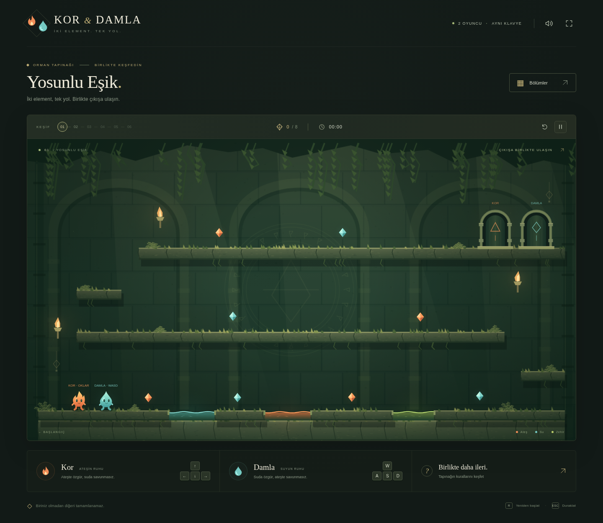

# 02 · Kor & Damla — Ateş ve Su

İki kişilik, Türkçe bir HTML5 / Canvas 2D bulmaca ve platform oyunu. Bir fiziksel klavyede iki karakter aynı anda oynanır. Ateş–su işbirliği, element havuzları, elmaslar, kollar, basılı tutulan düğmeler, itilebilir sandıklar, hareketli taşlar ve iki karakterin birlikte çıkışa ulaşması uygulanmıştır.

**Kapsam:** Altı özgün bölüm ve bu proje için sıfırdan çizilmiş görseller içerir. Orijinal Fireboy and Watergirl oyununun birebir harita, fizik veya animasyon kopyası değildir. Talep edilen tam harita eşleşmesi ve gerçek Android Brave cihaz testi henüz doğrulanmamıştır. Ayrıntılar [araştırma ve karşılaştırma notlarında](docs/RESEARCH.md).



## Hemen oyna

1. [Tek dosyalık HTML](dist/ates-ve-su-tek-dosya.html) dosyasını indirin. GitHub dosya sayfasındaki **Download raw file** düğmesini kullanabilirsiniz.
2. Dosyayı güncel tarayıcıda açın. Harici görsel, yazı tipi, kütüphane veya ağ isteği gerekmez.
3. Alternatif olarak `dist/index.html` dosyasını yanında diğer kaynak dosyalarıyla açın.

Yerel sunucu seçeneği:

```sh
python3 -m http.server 8080 --directory 02-ates-ve-su/dist
```

Depo kökünden çalıştırın ve `http://localhost:8080` adresini açın. Dosya olarak açılan sürüm ile HTTP sürümünün kayıt alanları farklı olabilir.

## Android Brave ve fiziksel klavye

Bluetooth veya USB klavyeyi Android'e bağlayın. HTML dosyasını Brave'de açın; dosya yöneticiniz tarayıcıda açmaya izin vermiyorsa dosyaları bir statik sunucudan sunun. Android'in dosya açma ve `content://` davranışı dosya yöneticisine göre değişebilir.

Yatay ekran önerilir. **F** ile tam ekrana geçin; **F** ile çıkın. Tarayıcı ekran yönünü kilitlemeye izin vermiyorsa Android'de yatay yönü seçin. Oyun hareketi için dokunmatik düğmeler bulunmaz. Menü düğmeleri hem fare hem dokunmayla kullanılabilir.

Bu ortamda Chromium'un Android emülasyonunda yatay ve dikey ekranlar, fiziksel klavye olayları ve tam ekran sınandı. Gerçek Android Brave, Bluetooth / USB klavye ve telefon performansı sınanmadı. Bazı klavyelerde eşzamanlı çok sayıda tuşun algılanması donanıma bağlıdır.

## Kontroller

| Eylem | Kor — ateş | Damla — su |
| --- | --- | --- |
| Hareket | ← / → | A / D |
| Zıplama | ↑ | W |
| Yakındaki kolu çevirme | ↓ | S |

Zıplama tuşunu erken bırakmak kısa sıçrama yapar. Basılı tutmak sürekli zıplatmaz. Sandıklar yürüyerek itilir. Düğmelerin üstünde karakter veya sandık dururken ilgili geçit açık kalır. Kollar çevrildikten sonra konumlarını korur.

**R:** Bölümü yeniden başlat · **Esc / P:** Duraklat / devam et · **F:** Tam ekran · **M:** Ses aç / kapat.

Kor ateş havuzunda, Damla su havuzunda güvendedir. Karşı element ve yeşil zehir bölümün yeniden denenmesine yol açar. Her karakter yalnız kendi rengindeki elmasları toplar. Her ikisi de kendi kapısının içinde, zeminde durduğunda bölüm tamamlanır; elmas toplamak çıkış için zorunlu değildir.

## Bölümler ve kayıt

1. **Yosunlu Eşik:** Hareket, elementler ve ortak çıkış.
2. **Güneşin Kolu:** Kalıcı kol ve taş geçit.
3. **Ayın Ağırlığı:** Sandık, düğme ve basılı tutulan geçit.
4. **Yükselen Taş:** Hareketli platform ve zamanlama.
5. **Zehirli Sessizlik:** Ek zehir havuzu, sandık ve yükselen taş.
6. **İki Işığın Tapınağı:** İki ayrı geçit, düğme, kol ve yükselen taş.

Bir yıldız bitirmeye, bir yıldız bütün elmaslara, bir yıldız bölümün hedef süresinden hızlı bitirmeye verilir. Açılan bölümler, en iyi süreler, yıldızlar ve ses seçimi `localStorage` içinde `kor-damla-progress-v1` anahtarıyla saklanır. Kayıt erişimi engellendiğinde oyun çalışmaya devam eder. Açık bir bölümün içindeki anlık konum kaydedilmez. Sekme gizlenince veya pencere odağı kaybolunca oyun duraklar.

## Geliştirme ve test

Çalıştırmak için paket kurulumu veya derleme gerekmez. Node.js 20+ ile bağımlılıksız fizik ve bölüm testleri:

```sh
cd 02-ates-ve-su
node --test tests/engine.test.cjs
```

Tarayıcı testleri için Playwright ve Chromium gerekir:

```sh
npm install --no-save --package-lock=false playwright
python3 -m http.server 8082 --bind 127.0.0.1 --directory dist
# Ayrı bir terminalde:
BROWSER_PATH=/usr/bin/chromium node tests/browser.test.cjs
```

Sunucu farklı bir adresteyse `GAME_TEST_URL` değişkenini ayarlayın. Test ekran görüntüleri varsayılan olarak `/workspace/scratch` altına yazılır; `GAME_TEST_OUTPUT` ile başka bir çıktı klasörü seçilebilir.

Paketleri kaynaklardan yeniden üretme:

```sh
python3 tools/package.py
```

- `dist/index.html`, `style.css`: Arayüz ve duyarlı yerleşim.
- `dist/levels.js`: Altı özgün bölümün geometrisi ve nesneleri.
- `dist/engine.js`: Tarayıcıdan bağımsız, 120 Hz sabit adımlı fizik.
- `dist/art.js`: Çizimler, karakterler, animasyonlar ve parçacıklar.
- `dist/game.js`: Klavye, arayüz, kayıt, ses ve oyun döngüsü.
- `dist/ates-ve-su-tek-dosya.html`: Bütün oyun tek HTML içinde.
- `dist/ates-ve-su-kaynak-kodu.zip`: Kaynak, test ve belge paketi.

Görseller, arka plan dokuları ve animasyonlar Canvas üzerinde programatik olarak çizilir. Statik tapınak arka planı önbelleklenir; piksel oranı en çok 2 olur. Harici oyun motoru veya görsel varlık kullanılmaz. Depo kökündeki [lisans](../LICENSE) geçerlidir.
